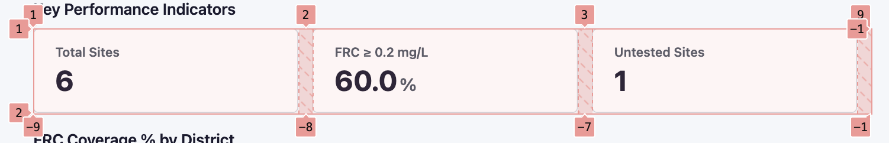
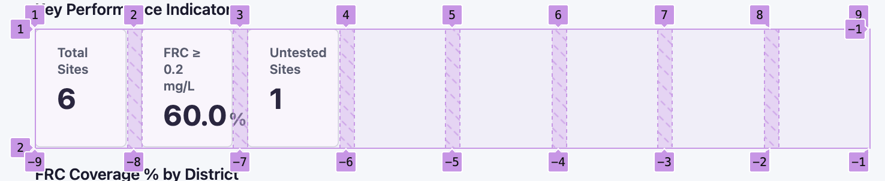

## Part A

### Section 1 : Core Web (HTML / CSS)
1. <header> tag for the header, <aside> tag for sidebar, <main> for the main KPI area, <footer> tag for the footer. 

Semantic structure improves accessibility and SEO, and helps screen readers and search engines understand the content of the page. Public sector audience may include people with low vision, color blindness, etc. And the semantic tags act as landmarks for the page.

2. 
```css
.kpi-grid {
  display: grid;
  grid-template-columns: repeat(auto-fit, minmax(220px, 1fr));
  gap: 16px;
}
```

Both the auto-fit and auto-fill create auto responsive layout with maximum number of possible columns. But the difference is, if there are lesser items than the number of possible columns, auto-fit will expand each item to fill the available space whereas autofill will leave the remaining space empty. For example, see the images below, where 9 possible columns are there but we only have 3 items
```css
grid-template-columns: repeat(auto-fit, minmax(100px, 1fr));
grid-template-columns: repeat(auto-fill, minmax(100px, 1fr));
```

auto-fit will expand each item to fill the available space **(collapse empty slots)**


auto-fill will not collapse the empty columns **(preserves empty space)**

3. Things to do to make charts meet WCAG AA:
a. Provide equivalent tabular data for charts
b. Use sufficient contrast between colors
c. Ensure charts are keyboard accessible and navigable (filters and controls).


### Section 2 : JavaScript & JSON
4. As per the implementation the sites with null values might not be tested and may be done in future. Thus we cannot consider them as pass or fail. As for pass percentage, it will be from the tested sites only thus the denominator is only tested sites. 
```js
function frcCoverageByDistrict(data) {
  const acc = {};

  for (const s of data.sites) {
    const d = (acc[s.district] ??= { tested: 0, pass: 0 });

    if (s.frc_mgl == null) continue;

    d.tested++;

    if (s.frc_mgl >= 0.2) d.pass++;
  }

  return Object.fromEntries(
    Object.entries(acc).map(([k, v]) => [
      k,
      v.tested ? Math.round(100 * v.pass / v.tested) : null
    ])
  );
}
```

5. 
```js
async function fetchData(url, maxRetries=3) {
  setLoading(true);

  try {
    for (let attempt = 0; attempt <= maxRetries; attempt++) {
      const response = await fetch(url);

      if (response.ok) {
        return await response.json();
      }

      if (response.status === 429 && attempt < maxRetries) {
        const delay = Math.min(1000 * 2 ** attempt, 8000);
        await new Promise(resolve => setTimeout(resolve, delay));
        continue;
      }

      throw new Error(`Request failed: HTTP ${response.status}`);
    }
  } catch (error) {
    showError(error.message);
    throw error;
  } finally {
    setLoading(false);
  }
}
```
The 429 status code is for "Too Many Requests" or "Rate Limited". Services like Google Sheets, or APIs in general, have certain rate limits, lets say 100 requests per minute. Thus it saves resource and API abuse. 

6. 
```js
const totals = rows.reduce((acc, row) => {
  const district = row.district;
  
  if (!acc[district]) {
    acc[district] = 0;
  }
  acc[district] += row.deviceCount;
  
  return acc;
}, {});
```


### Section 3 : Architecture & Integration
7. 
```js
const KPI_CONFIG = [
      {
        id: 'total-sites',
        label: 'Total Sites',
        compute(sites) {
          const safeSites = Array.isArray(sites) ? sites : [];
          return {
            value: safeSites.length,
            unit: ''
          };
        }
      },
      {
        id: 'frc-compliance',
        label: 'FRC \u2265 0.2 mg/L',
        compute(sites) {
          const safeSites = Array.isArray(sites) ? sites : [];
          let testedCount = 0;
          let passingCount = 0;

          for (const site of safeSites) {
            if (site && site.frc_mgl !== null && typeof site.frc_mgl === 'number' && !Number.isNaN(site.frc_mgl)) {
              testedCount++;
              if (site.frc_mgl >= 0.2) {
                passingCount++;
              }
            }
          }

          if (testedCount === 0) {
            return {
              value: '\u2014',
              unit: ''
            };
          }

          const percentage = (passingCount / testedCount) * 100;
          return {
            value: percentage.toFixed(1),
            unit: '%'
          };
        }
      },
      {
        id: 'untested-sites',
        label: 'Untested Sites',
        compute(sites) {
          const safeSites = Array.isArray(sites) ? sites : [];
          let untestedCount = 0;

          for (const site of safeSites) {
            if (site && site.frc_mgl === null) {
              untestedCount++;
            }
          }

          return {
            value: untestedCount,
            unit: ''
          };
        }
      }
    ];
```

8. In cases where API is not available, firstly we will need request, if possible, for authorized data export. 
If not available,though not advisable, then we can scrape the data from the web page (frontend). It will require an ETL pipeline, which may consist: 
  - **Extract the data:** It will consists of analyzing the structure of the HTML, identifying and extracting the data, storing the data. It might require authentication and session management. We will need to keep meta info of the data extracted like time, the limit till which extracted, etc.
  - **Transform the data:** The data extracted extracted from previous step might not be clean and well structured, as being on html page the structure might vary with time. Thus it requires cleaning and transformation into structured format. 
  - **Load the data:** The cleaned and structured data is loaded into the database and served for respective purposes.

9. Content security policy, to control valid sources (trusted ones). Sandbox, to allow form submissions, script loading, etc. X-Frame-Options, to prevent clickjacking, to control where the iframe can be embedded. X-Content-Type-Options, to prevent MIME sniffing.

10. While working with Nodejs or Reactjs, when we need to work with a external package, add it in package manager and install it locally. We can follow similar concept and install Chart.js library locally. While we get access to the package locally, we will need to load it using script, thus we can cache and serve it via CDN on our own for better performance. Also we would need to manually check for patches, updates, etc.

### Section 4 : Data-Visualisation Judgment
11. To show all the 25 sites data over 6 months we can use heatmap, to show each sites performance. Instead of making a single chart encorporating all the 25 companies we can group them based on certain prameters and do comparions using line or bar charts. 

For colour accessibility, we can follow the WCAG structure and instead of single color we can use different patterns, labels, etc. And just its opposite can be avoided, like using monochrome bars side by side or congested charts. 


---
## Part B

[🚀 View Live Dashboard](https://ajay-kr.github.io/eaii-advisors-evidence-action/)

Included files: 
./index.html
./data.json